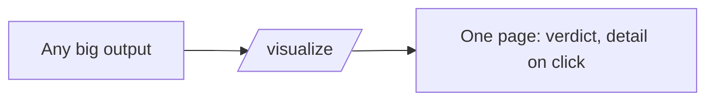
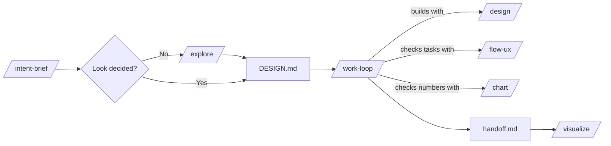

# Using the skills together

Which skills to run for which job, in what order, and when Work Loop is worth what it costs.

Interactive version: [Which skill when](https://www.automaitioninnovations.com/skills) on my site.

## Pick by the job

| The job | Run | Work Loop? |
|---|---|---|
| "Show me this" for any big answer, report or status | `visualize` | No |
| A small UI change you'll check yourself | `design` | No |
| A small UI change that must be proven done | `design` + `work-loop` | Yes |
| "Is this flow any good?" | `flow-ux` | No |
| Fix a flow until it works | `flow-ux` fix | Optional |
| A finished build you want proven and trusted | add `work-loop` to any of the above | Yes |
| Not sure what it should look like (look is open) | `explore`, then `design` | No |
| A chart or a page of numbers | `chart` | No |
| A bigger UI or UX change, a new feature, a client build | `intent-brief`, then the rest below | Yes |

## Everyday: one skill

Most days you need one skill. `visualize` alone turns a report, research or status into a page you can scan. `design`, `flow-ux` and `chart` also work alone.

## Bigger work: start with the intent

1. **`intent-brief`** writes `INTENT.md`: the outcome, why, what done means, hard limits, and **Who uses it** (each person, their task, and the screen that means they finished).
2. **`explore`** only if the look isn't decided. It researches, builds clickable concepts, and you pick one. The pick goes into `DESIGN.md`.
3. **`work-loop`** does the build, one done item at a time, and checks each one before moving on:
   - visual items: `design` builds them, and the [quality check](../skills/design-kit/quality-check.md) proves them (the page checker, desktop and phone screenshots, a critique)
   - user tasks: `flow-ux` walks each task and fixes it until no blocker or major problem is left
   - charts: `chart`'s rules and checks
4. At the end a fresh reviewer goes over it, and you get `handoff.md`. Run **`visualize`** on it to see the result as a page.

Look choices happen **before** the loop. The loop never picks between styles.

## When Work Loop is worth it

Work Loop costs more: it checks every item, fixes, re-checks, and runs a separate review. Use it when being wrong costs more than the extra run.

**Use it when:**
- there are several done items, or the change touches more than one screen
- people must be able to finish a task (sign-up, checkout, setup)
- someone else will review or ship it, so you need evidence
- you're handing it off and walking away

**Skip it when:**
- it's a quick page or one small change you'll look at yourself
- you're exploring or deciding taste (that's `explore`)
- you only need a page made from existing output (`visualize`)

## What the tests showed

We ran the same tasks several ways and had a judge score each result blind, out of 25 (fit to the job, works, clarity, trust, craft). Tokens and time are for the whole run. The harness and tasks are in [evals/](../evals/).

| Task | Run | Score /25 | Tokens | Time |
|---|---|---|---|---|
| Client tracker (build, 2 judges, average) | plain Claude | 19.5 | 62k | 97 s |
| | `design` | 21 | 93k | 271 s |
| | `design` + `work-loop` | **24** | 106k | 353 s |
| | `explore` + `design` | 20 | 99k | 270 s |
| | `explore` + `design` + `work-loop` | 21 | 125k | 490 s |
| | `intent-brief` + `explore` + `design` + `work-loop` | 21 | 123k | 443 s |
| Sign-up (build) | plain Claude | 16 | 55k | 62 s |
| | `design` | **22** | 101k | 304 s |
| | `design` + `flow-ux` | **22** | 124k | 446 s |
| Status from notes (3 judges) | plain Claude | 18 to 20 | 55k | 42 s |
| | `visualize` | 19 to 20 | 83k | 103 s |
| | `visualize` + `work-loop` | **23** | 96k | 166 s |
| Cafe report (numbers, after fixes) | plain Claude | 21 | 58k | 69 s |
| | `chart` | 21 | 84k | 132 s |
| | `visualize` | 23 | 93k | 198 s |
| | `chart` + `visualize` + `design` | **24** | 115k | 230 s |

**What it means:**
- **Work Loop paid off every time it was added:** +2 to +3 points (design + loop led with both judges on the tracker), for about 10 to 20% more tokens and 30 to 60% more time. It wins on trust: it checks facts against the source and refuses to guess.
- **The design skills beat plain Claude on builds** (+6 on the sign-up), at roughly twice the tokens.
- **Visualize beats plain on numbers:** 23 vs 21 on the cafe report after fixes, 24 when stacked with `chart` and `design`.
- **Explore didn't help when the spec was already clear** (20 vs 21 for `design` alone on the tracker). Use it only when the look is open.
- **Flow UX added cost but no points on a build that was already solid.** Use it when a flow feels wrong, or as Work Loop's check on user tasks, not on every build.
- **For a quick page, plain Claude is close.** After fixes, `visualize` alone edged ahead on the status page (20 vs 18); Work Loop scored 23 with all three judges.
- Every weakness these tests found has since been fixed in the skills, and most runs above happened before those fixes.

One task each, one or two judges: treat these as a guide, not a benchmark. Re-run them when a new model comes out.

## Each skill alone, or together

| Skill | Alone | With the others |
|---|---|---|
| `intent-brief` | A one-page brief | Feeds every other skill: done items, limits, who uses it |
| `explore` | Concepts and a comparison page | Its pick becomes the fixed look in `DESIGN.md` for `design` and the loop |
| `design` | Builds one screen or page in your taste | The loop calls it for every visual item; pulls in `flow-ux` and `chart` rules |
| `flow-ux` | Walks a flow, ranks problems, fixes on request | The loop's check for every user task; `design` builds its fixes |
| `chart` | Picks and checks charts | `design` and `visualize` follow its rules for numbers |
| `visualize` | Turns any output into a page | Shows the loop's handoff, `flow-ux` reports and project status |
| `work-loop` | Finishes any `INTENT.md` with evidence | Uses all of the above as its builders and checks |

## Tips

- Say the skill's name to run it: `/visualize` in Claude Code, `$visualize` in Codex. None of them start on their own.
- Keep your own taste in `~/.ai-skills/personal/taste.md`. Every design skill reads it.
- Every design skill runs the page checker before it calls a page done. You can run it yourself: `node skills/design-kit/scripts/check-page.mjs <page>`.
